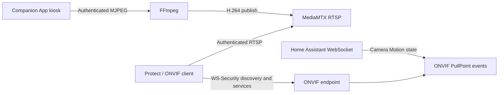

# Tablet ONVIF

Turn a wall-mounted tablet running the Home Assistant Companion App into an authenticated ONVIF camera, including motion events from its existing Camera Motion sensor.

**Developer preview — 0.2.5.** This repository contains a first implementation and automated protocol checks. Live adoption by UniFi Protect, a full container build, and sustained real-iPad video have not yet been validated. It is not ONVIF certified. Do not treat it as a proven surveillance appliance.

## What it does

- One Home Assistant app (formerly add-on), containing the bridge, FFmpeg, and MediaMTX.
- Discovers Companion App cameras using HA's device/entity registries, including renamed entities.
- Reads the Camera Stream URL attribute automatically, with a manual URL override.
- Converts MJPEG into H.264 main and sub RTSP streams, plus JPEG snapshots.
- Implements ONVIF Device, Media and PullPoint Events endpoints with actual credentials.
- Supports WS-Security UsernameToken PasswordDigest, HTTP Digest, and HTTP Basic; RTSP reads require NVR credentials too.
- Subscribes directly to Home Assistant state events: no MQTT broker, automations, external iPad app, or Frigate dependency.
- Sends motion-active and motion-clear edges; reconnects to HA and retries interrupted video.
- Provides an ingress setup UI, live MJPEG preview, snapshots, connection diagnostics and redacted configuration responses.

The iPad stays in Home Assistant's Companion App kiosk mode. No native iPad application is part of this project. The camera must be explicitly enabled on the tablet and remains subject to iOS foreground restrictions. This bridge cannot keep an iPad camera running after iOS stops it.



## Installation guide

Follow these steps in order. Start with one iPad and verify video and motion in your recorder before adding more tablets.

1. [Enable the iPad camera sensors](#1-enable-the-ipad-camera-sensors).
2. [Install and configure the Home Assistant app](#2-install-and-configure-the-home-assistant-app).
3. [Connect your NVR](#3-connect-your-nvr).
4. Optionally, [add a camera entity in Home Assistant](#optional-add-a-camera-entity-in-home-assistant).

### Before you start

You need:

- An iPad running the **Home Assistant Companion App**, connected to the Home Assistant server that will run Tablet ONVIF. Opening HA in Safari alone does not provide the Companion App camera sensors.
- A Companion App version that offers **Camera Stream** and **Camera Motion**. If those sensors are missing, update the Companion App and check device support before continuing.
- **Home Assistant OS**, with administrator access to install apps. Supported host architectures are **amd64** and **aarch64**. If you run Home Assistant Container without the app store, use [Standalone Docker on Linux](#standalone-docker-on-linux) instead.
- A local network connection from the HA host to the iPad, and from the NVR to the HA host. The bridge runs on the **HA server**, not on the iPad or NVR.
- An NVR that accepts third-party **ONVIF cameras with H.264 video**. Motion recording also needs support for this bridge's ONVIF PullPoint motion events; raw RTSP input alone does not carry those events.
- Internet access on the HA host for the initial image build. Python, FFmpeg and MediaMTX are included; you do not install them separately.

No MQTT broker, Frigate, go2rtc installation, Proxmox server or extra camera app is required.

### 1. Enable the iPad camera sensors

On the **iPad**:

1. Open the Home Assistant Companion App and select your HA server.
2. Go to **Settings → Companion app → Sensors**. If multiple servers are configured, enable the sensors for the server running this bridge.
3. Enable **Camera Motion** and grant camera permission when prompted.
4. Enable **Camera Stream**. In its settings, optionally set a **Username** and **Password**. Keep these for step 2. The default stream port is **8090**.
5. Leave the Companion App open in the foreground. For wall use, keep it powered and configure kiosk mode so the app remains visible. Locking the iPad or switching apps can interrupt the camera.

Both sensors use the front camera. The stream reports `idle` without a viewer and `streaming` with viewers; `idle` is not an error. Motion sensitivity and clear delay are configured in **Camera Motion** settings. See the [official Companion sensor documentation](https://companion.home-assistant.io/docs/core/sensors/#camera-stream-sensor).

On **Home Assistant**:

1. Open **Settings → Devices & services → Devices** and select the iPad's Companion App device.
2. Confirm that **Camera Stream** and **Camera Motion** exist and are enabled. Their entity IDs will resemble:

   ```text
   sensor.garage_ipad_camera_stream
   binary_sensor.garage_ipad_camera_motion
   ```

   These are examples; your names may differ. The bridge discovers the actual entities, including renamed ones.

3. Open **Camera Stream** and check its attributes for a **Stream URL**. The motion entity should report `on` or `off`, rather than `unavailable`.
4. If the entities have not appeared yet, return to the iPad and refresh the Companion App's sensors/dashboard, then check again.

**Checkpoint:** both entities are present on the same iPad device, and Camera Stream has a Stream URL. You do not need to create a separate MJPEG camera integration first. `sensor.…_camera_stream` is a status sensor, not itself a playable `camera.*` entity.

### 2. Install and configure the Home Assistant app

#### Add this repository and install

1. In Home Assistant, open **Settings → Apps → Install app**. Older HA versions call this **Settings → Add-ons → Add-on Store**.
2. Open the **⋮** menu and select **Repositories**.
3. Add this repository URL:

   ```text
   https://github.com/ryanlevi/tablet-onvif
   ```

4. Close the repository dialog, refresh the store if needed, and find **Tablet ONVIF** under **Tablet ONVIF Apps**.
5. Open it and select **Install**. The app builds from source; wait for the installation to finish. Check Supervisor logs if the build fails.
6. Enable **Start on boot**. Optionally enable **Show in sidebar**.
7. Select **Start**, then **Open Web UI**. No HA token or separate web login is required through Home Assistant ingress.

See HA's [third-party app repository instructions](https://www.home-assistant.io/common-tasks/os/#installing-a-third-party-app-repository) if the repository does not appear. This is an app-store repository, not a HACS integration.

#### Enable your tablet in the bridge

1. Wait for **Home Assistant connected** at the top of the Web UI.
2. Under **Add a tablet**, find the iPad and select **Set up**. Use **Refresh** if it has just been enabled.
3. Keep its suggested camera name, or choose a name your NVR will recognize.
4. If you configured a login on the iPad, select **The tablet's stream uses a password** and enter that exact username and password. These are camera-stream credentials, not your Home Assistant account login.
5. Select **Enable camera**. The bridge detects its LAN address, chooses an available ONVIF port and starts the video encoder.
6. Wait for **Video ready**, then select **Live view**. You should see the iPad camera. If the browser cannot display MJPEG, it switches to **Compatibility preview**, which updates once per second. This fallback changes only the web preview, not the NVR stream's configured frame rate.
7. Move in front of the iPad and check that **Motion clear** changes to **Motion detected**, then clears after the tablet's configured delay.

**Checkpoint:** the bridge shows video ready, a current picture, and motion changes. Browser preview alone does not prove NVR interoperability; complete step 3.

#### Find the NVR connection details

On the camera card, select **Connect to NVR**:

- **Camera address:** the bridge/HA host's LAN address. Use this instead of the iPad IP or HA ingress URL.
- **Username / Password:** the camera's NVR login. Select **Show password** or **Copy password** when needed.
- Under **Manual adoption:** the ONVIF service URL and camera-specific ONVIF port.

For a newly configured camera, a supplied iPad stream login is also used for NVR access. If the iPad stream has no login, the bridge generates an authenticated NVR login. Existing saved NVR logins remain unchanged, so always use the values displayed here. Changes to a shared tablet/bridge login also require updating the saved login in your NVR.

You normally do not need **Advanced settings**. If the detected address is unreachable from the NVR, open the camera's settings (**⋯**) and override the bridge address with the correct HA host LAN IPv4 address.

### 3. Connect your NVR

#### Any ONVIF-compatible recorder

Menu names differ by NVR; the required connection details are the same:

1. Open your NVR's **Add camera**, **Add device** or equivalent screen.
2. Choose **ONVIF**. If discovery lists the camera name you set above, select it.
3. Enter the **Username** and **Password** from **Connect to NVR**.
4. If discovery does not find it, use manual ONVIF setup. Enter the displayed **Camera address** and **ONVIF port**. If the recorder asks for a complete service URL, paste the **ONVIF service URL** from **Manual adoption**. Do not substitute the HA web port or iPad stream port.
5. Select **TCP** for RTSP transport if asked. The bridge provides H.264 main and sub streams; the recorder retrieves their addresses through ONVIF.
6. Save/add the camera and open its live view. Configure the NVR's recording schedule, storage and retention as you would for any other camera.
7. If you want motion-triggered recording, enable the NVR's **camera/ONVIF motion events** and corresponding recording rule. Walk in front of the iPad, wait for motion to clear, and confirm that the NVR receives the event and records a playable clip.

ONVIF clients vary. This project remains a developer preview: adoption, recording and motion behavior must be checked on your actual recorder. It does not provide audio, PTZ or person/vehicle/animal AI classifications. A recorder's own image-based motion detector is separate from the camera motion events sent by this bridge.

#### UniFi Protect / UNVR

1. Open **UniFi Protect → Settings → System**.
2. Enable **Discover Third-Party Cameras**.
3. Open **UniFi Devices** and find the tablet camera, then select **Click to Adopt**.
4. Enter the NVR username and password shown in **Connect to NVR**. Neither a UniFi account password nor a Home Assistant account password is used here.
5. After adoption, open the live view. Protect uses the bridge's main/sub streams as HQ/LQ.
6. Configure recording and verify a real motion event and recorded clip. This bridge's actual Protect adoption and motion timeline behavior are still awaiting validation.

For Protect's supported setup process, see [Ubiquiti's third-party camera guide](https://help.ui.com/hc/en-us/articles/26301104828439-Third-Party-Cameras-in-UniFi-Protect). If the camera is not discovered, check the network requirements below; a generic NVR's manual service-URL field should not be assumed to exist in Protect.

#### Network requirements and discovery

| Connection                             | Default port                                                    | Purpose                                                                                                |
| -------------------------------------- | --------------------------------------------------------------- | ------------------------------------------------------------------------------------------------------ |
| HA host → iPad                         | TCP 8090                                                        | Read the Companion App stream; use the actual port configured on the iPad                              |
| NVR → HA host                          | TCP 8101 for the first camera; later ports chosen automatically | ONVIF login, media information, snapshots and motion subscriptions; use the port shown for each camera |
| NVR → HA host                          | TCP 8556                                                        | Authenticated RTSP video; configurable in Advanced settings                                            |
| NVR ↔ HA host on the discovery subnet | UDP 3702                                                        | ONVIF WS-Discovery multicast                                                                           |
| HA Supervisor ingress → app            | TCP 8099                                                        | Web administration; not the camera endpoint to enter into an NVR                                       |

Discovery generally stays within one subnet. Across VLANs, allow the routed ONVIF and RTSP connections and use manual setup where the NVR supports it; multicast discovery needs separate network support. A working HA web page does not prove these camera ports are reachable.

Use DHCP reservations for the iPad and HA host to keep their addresses stable. Keep the HA/NVR clocks synchronized for time-sensitive ONVIF authentication. Check port conflicts if you already run Frigate or another media server. Keep the camera endpoints on trusted networks; public port forwarding is not required.

### Optional: add a camera entity in Home Assistant

You can use the bridge for both an NVR and Home Assistant:

1. On the camera card, select **Add to Home Assistant**. This opens the built-in **ONVIF** integration setup in a new tab through My Home Assistant. Select/check your HA instance URL if prompted.
2. Enter the bridge **Camera address**, **ONVIF port**, **Username** and **Password** from **Connect to NVR**. The button opens setup; it does not transfer credentials or create the integration automatically.
3. Complete the setup and check the new camera entity under **Settings → Devices & services → ONVIF**. Use it in your dashboard like another HA camera.
4. If the link is unavailable, open **Settings → Devices & services → Add integration → ONVIF** manually and enter the same details.

The [HA ONVIF integration](https://www.home-assistant.io/integrations/onvif/) supports H.264 profiles. Actual compatibility with this bridge still needs deployment validation. On current HA, this is a separate ONVIF device; it is not added under the iPad's existing Companion App device. See [HA's device ownership model](https://contributors.home-assistant.io/blog/2026/07/21/device-registry-single-config-entry/).

### Updating and keeping your configuration

**Repository installation:** refresh/check for updates in the app store, open Tablet ONVIF and select **Update** when a new version appears. Restart it if necessary and refresh the Web UI. Camera identities and saved settings are stored in persistent app data; keep that data when updating and include it in your HA backups.

**Local source installation:** if you copied the `tablet_onvif` directory into the local apps folder, update that copy first. On installations using the legacy `/addons` mount, that directory is `/addons/tablet_onvif`. Then reload the store and update the installed local app:

```sh
ha store reload
ha addons update local_tablet_onvif
```

The local slug is specific to a local installation; repository installations have a repository-specific slug. A rebuild alone may leave the installed version metadata unchanged. Compare the app's installed version with `tablet_onvif/config.yaml`, not just its changelog.

Avoid uninstalling to perform a routine update. Removing app data loses the persistent installation identity and can require adopting the camera again. Keep existing NVR credentials when a camera has already been adopted.

### If setup stops working

| Symptom                                           | What to check                                                                                                                            |
| ------------------------------------------------- | ---------------------------------------------------------------------------------------------------------------------------------------- |
| iPad missing from Add a tablet                    | Correct HA server selected on the iPad; both sensors enabled and registered on its device; press Refresh                                 |
| Camera Stream is unavailable or has no Stream URL | Companion App open in the foreground, camera permission granted, Camera Stream enabled                                                   |
| Source credentials rejected                       | Use the iPad's Camera Stream username/password, not HA or NVR account credentials                                                        |
| Waiting for video / no fresh preview frame        | HA-to-iPad connectivity and port, tablet foreground state, encoder logs and possible port conflicts                                      |
| Compatibility preview appears                     | Automatic web-preview fallback; confirm it displays changing images, then test NVR video separately                                      |
| NVR cannot find the camera                        | Third-party/ONVIF discovery enabled, same discovery subnet, reachable advertised address, ONVIF/RTSP firewall rules                      |
| NVR rejects the login                             | Re-copy the displayed NVR login, use the camera-specific ONVIF port, check HA/NVR clocks                                                 |
| NVR video works but motion does not               | Original Camera Motion sensor changes, bridge motion is available, and NVR accepts camera ONVIF events and has an enabled recording rule |

For further diagnosis, follow [Troubleshooting with debug logs](#troubleshooting-with-debug-logs). Include the installed version, the failed step and relevant redacted logs in an issue.

## Standalone Docker on Linux

```sh
cp .env.example .env
chmod 600 .env
# Edit HA_URL and HA_TOKEN locally; never commit the token.
docker compose up --build -d
```

The standalone admin listener binds to loopback. On a remote host, use an SSH tunnel:

```sh
ssh -L 8099:127.0.0.1:8099 user@your-linux-host
```

Read `data/admin-token` locally on that host and open `http://localhost:8099`. Paste the admin token into the login form. Do not share the token. The Docker stack uses Linux host networking for WS-Discovery; Docker Desktop is not the target deployment.

`ADMIN_HOST` can be changed deliberately for a private management network, but the UI then needs TLS via a trusted reverse proxy. NVR-facing ONVIF and RTSP ports are authenticated independently of the admin UI.

## Troubleshooting with debug logs

In Home Assistant, open **Tablet ONVIF → Configuration**, enable **Debug logging**, save and restart the app. Reproduce the problem once, then open its **Logs** tab. Disable debug logging and restart after troubleshooting.

```yaml
debug_logging: true
```

Standalone Docker can set `DEBUG_LOGGING=true` in `.env` and recreate its container. The Supervisor `/data/options.json` option takes precedence when present. Debug logs include HA connection stages, source HTTP status, stream delivery, FFmpeg/MediaMTX output and ONVIF operations. They distinguish `source-check`, `encoder-relay` and `browser-preview`. If the UI reports video ready but live preview fails, share logs from immediately before clicking Live view through the failure.

Passwords, HA tokens, authorization headers and URL credentials/paths are redacted. Logs still include LAN endpoint addresses, camera IDs and entity IDs; review them before sharing publicly. SOAP bodies, options and settings are never dumped. Child output is bounded and truncated records are omitted.

## How motion behaves

The configured binary sensor is authoritative:

| HA state                                              | ONVIF motion state      | Diagnostics        |
| ----------------------------------------------------- | ----------------------- | ------------------ |
| `on`                                                  | Active                  | Motion available   |
| `off`                                                 | Clear                   | Motion available   |
| `unknown`, `unavailable`, missing, or HA disconnected | Clear any active motion | Motion unavailable |

Repeated identical states do not produce repeated events. Each NVR subscriber gets its own bounded event queue and an initial current-state notification. PullPoint subscriptions support polling, renewal, expiration, synchronization and unsubscribe. There is no extra occupancy timer: the Companion App's configured clear delay controls motion duration.

These are generic ONVIF motion events, not Protect person/vehicle/animal AI detections. The bridge has no AI model and does not modify Protect's database. Availability is reported honestly; stale frames are not served as a live picture.

## Network identity and multiple tablets

Each camera keeps a stable UUID and a distinct ONVIF-reported MAC across restarts using the persistent installation identity in `/data`. It has separate media profiles and a separate ONVIF port. Back up `/data` to preserve adoption identity.

Some Protect versions may identify virtual cameras using the actual layer-2 MAC instead of the ONVIF-reported MAC. **Multiple-camera adoption on one physical host is not yet validated.** If Protect merges cameras, distinct LAN IP/MAC interfaces will be needed; this preview deliberately does not create or modify host interfaces. `advertise_host` can reference an already configured virtual IP. Validate one tablet first.

Set the discovery interface IPv4 in the UI if the HA host has multiple network interfaces. UDP multicast discovery typically stays inside one subnet; manual adoption across VLANs requires routing/firewall access to the advertised ONVIF and RTSP ports.

## Development

Python 3.9+ for protocol development; container uses Python 3.12.

```sh
python3 -m venv .venv
.venv/bin/pip install -r tablet_onvif/requirements.txt -r requirements-dev.txt
.venv/bin/pytest -q
.venv/bin/ruff check tablet_onvif tests
node --check tablet_onvif/bridge/static/app.js
```

Read [architecture](docs/architecture.md), [security](SECURITY.md), and the [acceptance checklist](docs/acceptance.md) before deployment. Live media testing needs FFmpeg and MediaMTX, included in the container.

## Project status

Implemented: registry discovery, direct HA events, two H.264 profiles, snapshots, authenticated protocol services, persistent identity, ingress UI, standalone Docker packaging, reconnect handling, bounded event state and automated checks.

Pending: actual UNVR adoption and motion timeline validation, complete Docker image execution, long-duration iPad testing, multiple-camera identity validation, optional HA diagnostic entities, and release image publication. UI settings currently restart the entire bridge. Default UI errors stay concise; opt-in debug logging includes sanitized FFmpeg and RTSP server output.

## References

- [Home Assistant Companion camera sensors](https://companion.home-assistant.io/docs/core/sensors/#camera-stream-sensor)
- [Home Assistant app development](https://developers.home-assistant.io/docs/apps)
- [Home Assistant WebSocket API](https://developers.home-assistant.io/docs/api/websocket/)
- [ONVIF specifications](https://www.onvif.org/profiles/specifications/)
- [MediaMTX authentication](https://mediamtx.org/docs/features/authentication)
- [UniFi Protect third-party cameras](https://help.ui.com/hc/en-us/articles/26301104828439-Third-Party-Cameras-in-UniFi-Protect)

MIT licensed original source. Runtime third-party components retain their own licenses; see [THIRD_PARTY.md](THIRD_PARTY.md).
