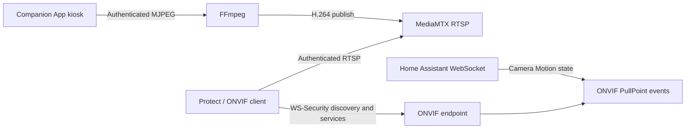

# Tablet ONVIF

Turn a wall-mounted tablet running the Home Assistant Companion App into an authenticated ONVIF camera, including motion events from its existing Camera Motion sensor.

**Developer preview — 0.1.1.** This repository contains a first implementation and automated protocol checks. Live adoption by UniFi Protect, a full container build, and sustained real-iPad video have not yet been validated. It is not ONVIF certified. Do not treat it as a proven surveillance appliance.

## What it does

- One Home Assistant app (formerly add-on), containing the bridge, FFmpeg, and MediaMTX.
- Discovers Companion App cameras using HA's device/entity registries, including renamed entities.
- Reads the Camera Stream URL attribute automatically, with a manual URL override.
- Converts MJPEG into H.264 main and sub RTSP streams, plus JPEG snapshots.
- Implements ONVIF Device, Media and PullPoint Events endpoints with actual credentials.
- Supports WS-Security UsernameToken PasswordDigest, HTTP Digest, and HTTP Basic; RTSP reads require NVR credentials too.
- Subscribes directly to Home Assistant state events: no MQTT broker, automations, external iPad app, or Frigate dependency.
- Sends motion-active and motion-clear edges; reconnects to HA and retries interrupted video.
- Provides an ingress setup UI, live MJPEG preview, snapshots, connection diagnostics and redacted configuration responses.

The iPad stays in Home Assistant's Companion App kiosk mode. No native iPad application is part of this project. The camera must be explicitly enabled on the tablet and remains subject to iOS foreground restrictions. This bridge cannot keep an iPad camera running after iOS stops it.



## Install on Home Assistant OS

For local development, copy the entire `tablet_onvif` directory into the HA local apps/add-ons directory (`/addons/tablet_onvif`, accessible through a suitable Samba/SSH app). In the Apps store, reload/check for updates, find the local Tablet ONVIF app, and install it. Builds download Python, FFmpeg and MediaMTX dependencies.

Start the app and select **Open Web UI**:

1. Wait for Home Assistant to connect. The Supervisor provides the HA API token automatically.
2. Select **Use this tablet**, or configure entity IDs manually if registry discovery isn't available.
3. Set the bridge host's LAN IPv4 address (the HA host address, not the iPad address), a free ONVIF TCP port, and a unique NVR username/password.
4. Enter the iPad stream credentials separately. The URL can be discovered from the Camera Stream sensor.
5. Save. In Live status, select **Show live stream** to check the tablet feed. The preview reads MJPEG directly from the iPad; RTSP video status separately reports the NVR encoder. A working preview alone does not establish RTSP/ONVIF compatibility.
6. Add the ONVIF endpoint to your NVR with the configured **NVR** credentials. The ONVIF endpoint returns an RTSP URL that uses the same credentials. The iPad source password is never used for NVR login.

For distribution, publish this Git repository and add its actual GitHub URL to the HA Apps store repositories. No remote repository has been created by this source package.

**Supported app architectures:** amd64 and aarch64. Runtime ports default to administration/ingress TCP 8099, RTSP TCP 8556, UDP 3702 discovery, and one configurable ONVIF TCP port per tablet (first suggested port 8101). Do not overlap ports used by Frigate or another media server.

## Standalone Docker on Linux

```sh
cp .env.example .env
chmod 600 .env
# Edit HA_URL and HA_TOKEN locally; never commit the token.
docker compose up --build -d
```

The standalone admin listener binds to loopback. On a remote host, use an SSH tunnel:

```sh
ssh -L 8099:127.0.0.1:8099 user@your-linux-host
```

Read `data/admin-token` locally on that host and open `http://localhost:8099`. Paste the admin token into the login form. Do not share the token. The Docker stack uses Linux host networking for WS-Discovery; Docker Desktop is not the target deployment.

`ADMIN_HOST` can be changed deliberately for a private management network, but the UI then needs TLS via a trusted reverse proxy. NVR-facing ONVIF and RTSP ports are authenticated independently of the admin UI.

## How motion behaves

The configured binary sensor is authoritative:

| HA state | ONVIF motion state | Diagnostics |
|---|---|---|
| `on` | Active | Motion available |
| `off` | Clear | Motion available |
| `unknown`, `unavailable`, missing, or HA disconnected | Clear any active motion | Motion unavailable |

Repeated identical states do not produce repeated events. Each NVR subscriber gets its own bounded event queue and an initial current-state notification. PullPoint subscriptions support polling, renewal, expiration, synchronization and unsubscribe. There is no extra occupancy timer: the Companion App's configured clear delay controls motion duration.

These are generic ONVIF motion events, not Protect person/vehicle/animal AI detections. The bridge has no AI model and does not modify Protect's database. Availability is reported honestly; stale frames are not served as a live picture.

## Network identity and multiple tablets

Each camera keeps a stable UUID and a distinct ONVIF-reported MAC across restarts using the persistent installation identity in `/data`. It has separate media profiles and a separate ONVIF port. Back up `/data` to preserve adoption identity.

Some Protect versions may identify virtual cameras using the actual layer-2 MAC instead of the ONVIF-reported MAC. **Multiple-camera adoption on one physical host is not yet validated.** If Protect merges cameras, distinct LAN IP/MAC interfaces will be needed; this preview deliberately does not create or modify host interfaces. `advertise_host` can reference an already configured virtual IP. Validate one tablet first.

Set the discovery interface IPv4 in the UI if the HA host has multiple network interfaces. UDP multicast discovery typically stays inside one subnet; manual adoption across VLANs requires routing/firewall access to the advertised ONVIF and RTSP ports.

## Development

Python 3.9+ for protocol development; container uses Python 3.12.

```sh
python3 -m venv .venv
.venv/bin/pip install -r tablet_onvif/requirements.txt -r requirements-dev.txt
.venv/bin/pytest -q
.venv/bin/ruff check tablet_onvif tests
node --check tablet_onvif/bridge/static/app.js
```

Read [architecture](docs/architecture.md), [security](SECURITY.md), and the [acceptance checklist](docs/acceptance.md) before deployment. Live media testing needs FFmpeg and MediaMTX, included in the container.

## Project status

Implemented: registry discovery, direct HA events, two H.264 profiles, snapshots, authenticated protocol services, persistent identity, ingress UI, standalone Docker packaging, reconnect handling, bounded event state and automated checks.

Pending: actual UNVR adoption and motion timeline validation, complete Docker image execution, long-duration iPad testing, multiple-camera identity validation, optional HA diagnostic entities, and release image publication. UI settings currently restart the entire bridge. Debugging intentionally uses coarse source errors rather than echoing FFmpeg lines containing credentials.

## References

- [Home Assistant Companion camera sensors](https://companion.home-assistant.io/docs/core/sensors/#camera-stream-sensor)
- [Home Assistant app development](https://developers.home-assistant.io/docs/apps)
- [Home Assistant WebSocket API](https://developers.home-assistant.io/docs/api/websocket/)
- [ONVIF specifications](https://www.onvif.org/profiles/specifications/)
- [MediaMTX authentication](https://mediamtx.org/docs/features/authentication)
- [UniFi Protect third-party cameras](https://help.ui.com/hc/en-us/articles/26301104828439-Third-Party-Cameras-in-UniFi-Protect)

MIT licensed original source. Runtime third-party components retain their own licenses; see [THIRD_PARTY.md](THIRD_PARTY.md).
